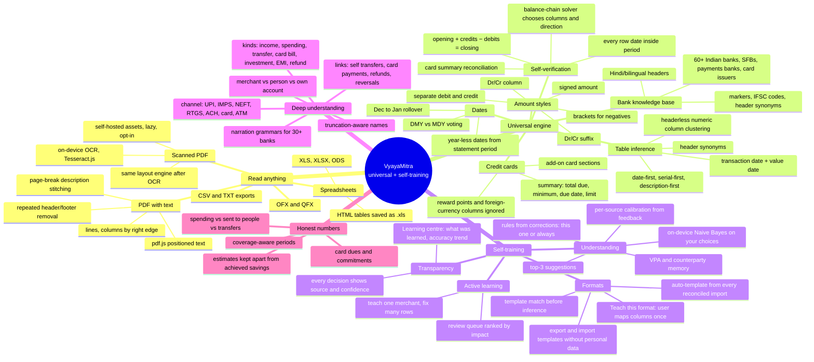
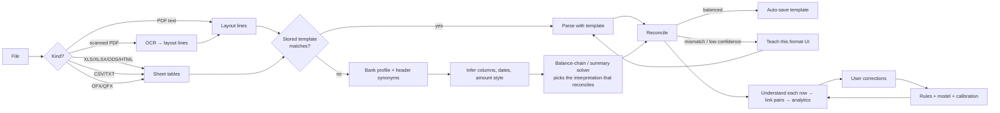

# Universal statements & self-training

VyayaMitra's goal: **read any bank or credit-card statement from any bank, and get smarter with every correction**, entirely on the user's device.

The design rests on two ideas:

1. **Statements verify themselves.** A bank statement's running balance (`previous ± amount = balance`) and a card statement's summary (`previous balance + charges − credits = total due`) let the engine *prove* an interpretation is right, instead of trusting a bank-specific script.
2. **Everything learned is reusable.** A format parsed and reconciled once becomes a template; a merchant categorised once becomes a rule; every correction becomes training data. None of it leaves the device, and none of it contains personal data except the user's own ledger.

## Mind map

## Pipeline

## Where things live

| Concern | Module |
|---|---|
| Bank knowledge base (names, IFSC, markers) | `src/domain/institutions.ts` |
| Universal PDF/sheet engine, templates applied, inspection for teaching | `src/parsing/**` |
| XLS/XLSX/ODS/HTML, OFX/QFX, OCR adapters | `src/parsing/adapters/**` |
| Template + feedback storage, auto-learning on import | `src/db/**`, `src/engine/import/**` |
| Narration grammars, merchant knowledge, learning, calibration, suggestions, review priority | `src/engine/understand/**` |
| Learning metrics, card dues | `src/engine/analytics/**` |
| Teach-format UI, smarter review queue | `src/features/import/**`, `src/features/activity/**` |
| Learning centre | `src/features/learning/**` |

## Privacy rules for learned artefacts

- A template stores only: lower-case marker phrases (bank names, domains, card brands), header labels, column geometry/indexes, and format flags. Never names, account numbers, addresses, amounts or descriptions. `draftTemplate` scrubs anything that contains a digit run of 4+ or looks like an address/name line.
- Feedback events and the learned model stay in the device's IndexedDB and in the user's own backups.
- Exported template files can be shared publicly; the importer re-validates and scrubs them.
